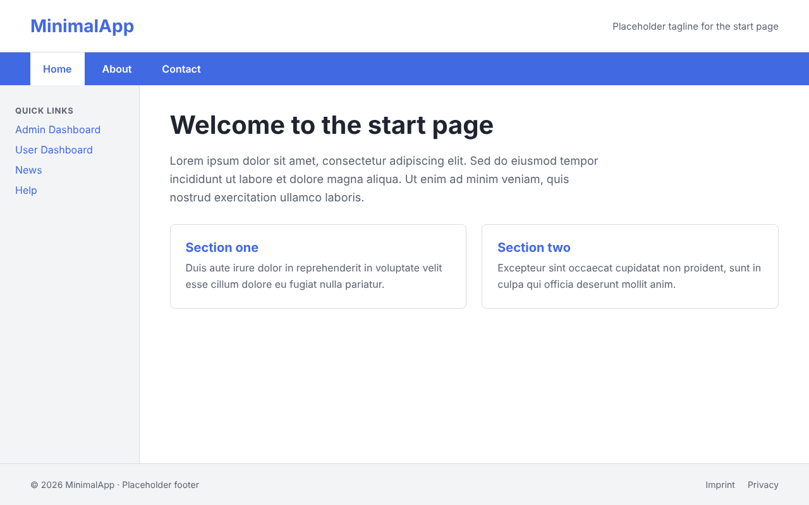
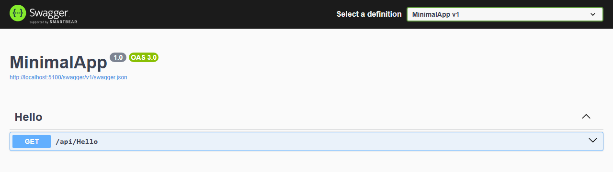

<div align="center">

# Minimal ASP.NET Core + React Starter


A minimal full-stack starter with an ASP.NET Core Web API backend and a React + Vite frontend, including a ready-made page layout. Intended as a clean base to build on.





</div>

---

## Features

- ASP.NET Core 8 Web API with Swagger UI and a CORS policy for the Vite dev server
- React 19 frontend with client-side routing (React Router 7)
- Standard page layout: header, navigation (Home, About, Contact), side links, main area and footer
- Color scheme: royal blue `#4169E1`, white and gray, defined as CSS variables in `frontend/src/index.css`
- Responsive: navigation and side links wrap below the content on narrow screens

---

## Project Structure

```
/
├── backend/                  # ASP.NET Core Web API
│   ├── Controllers/
│   │   └── HelloController.cs
│   └── Program.cs
├── docs/
│   ├── screenshot.png
│   └── backend-screenshot.png
└── frontend/                 # React + Vite
    └── src/
        ├── components/
        │   ├── Layout.jsx    # header, side links, main outlet, footer
        │   └── Navbar.jsx    # Home, About, Contact
        ├── pages/
        │   ├── Home.jsx
        │   ├── About.jsx
        │   ├── Contact.jsx
        │   ├── Placeholder.jsx
        │   ├── AdminDashboard.jsx
        │   └── UserDashboard.jsx
        ├── App.jsx
        ├── index.css
        └── main.jsx
```

---

## Prerequisites

- [.NET 8 SDK](https://dotnet.microsoft.com/download)
- [Node.js](https://nodejs.org/) (v20.19 or higher)

---

## Packages

Installed automatically by `dotnet run` and `npm install`.

**Backend (NuGet)**

| Package                | Version |
|------------------------|---------|
| Swashbuckle.AspNetCore | 6.6.2   |

**Frontend, dependencies (npm)**

| Package      | Version  |
|--------------|----------|
| react        | ^19.2.6  |
| react-dom    | ^19.2.6  |
| react-router | ^7.16.0  |

**Frontend, dev dependencies (npm)**

| Package                      | Version  |
|------------------------------|----------|
| vite                         | ^8.0.12  |
| @vitejs/plugin-react         | ^6.0.1   |
| eslint                       | ^10.3.0  |
| @eslint/js                   | ^10.0.1  |
| eslint-plugin-react-hooks    | ^7.1.1   |
| eslint-plugin-react-refresh  | ^0.5.2   |
| globals                      | ^17.6.0  |
| @types/react                 | ^19.2.14 |
| @types/react-dom             | ^19.2.3  |

---

## Getting Started

### Backend

```bash
cd backend
dotnet run
```

The API listens on `http://localhost:5100` and `https://localhost:7270` (see `backend/Properties/launchSettings.json`).  
Swagger UI: `http://localhost:5100/swagger`

### Frontend

```bash
cd frontend
npm install
npm run dev
```

The app will be available at `http://localhost:5173`.

---

## Routes

| Route      | Page                |
|------------|---------------------|
| `/`        | Home                |
| `/about`   | About               |
| `/contact` | Contact             |
| `/admin`   | Admin Dashboard     |
| `/user`    | User Dashboard      |
| `/news`    | News (placeholder)  |
| `/help`    | Help (placeholder)  |
| `/imprint` | Imprint (placeholder) |
| `/privacy` | Privacy (placeholder) |

---

## API Endpoints

| Method | Route       | Description             |
|--------|-------------|-------------------------|
| GET    | /api/hello  | Returns a hello message |

---

## CORS

The backend is configured to accept requests from `http://localhost:5173`.  
To change the allowed origin, edit the `ReactPolicy` in `Program.cs`.

---

## Notes

- No authentication is implemented. This is intentional for a minimal starter.
- The placeholder texts, the tagline, the quick links and the footer links in `Layout.jsx` and `pages/` are meant to be replaced.
